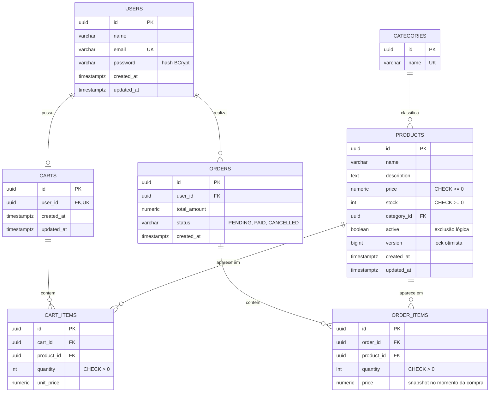

# E-commerce API

API RESTful de e-commerce desenvolvida para o **Desafio Backend (Focus Tech)**. Permite cadastro e login de usuários, consulta e gerenciamento de catálogo de produtos, carrinho de compras, checkout transacional e histórico de pedidos.

## Sumário

- [Tecnologias](#tecnologias)
- [Requisitos](#requisitos)
- [Variáveis de ambiente](#variáveis-de-ambiente)
- [Como executar](#como-executar)
- [Como executar os testes](#como-executar-os-testes)
- [Documentação das rotas](#documentação-das-rotas)
- [Formato de erros](#formato-de-erros)
- [Regras de negócio](#regras-de-negócio)
- [Concorrência de estoque](#concorrência-de-estoque)
- [Modelagem do banco](#modelagem-do-banco)
- [Arquitetura](#arquitetura)
- [Decisões técnicas](#decisões-técnicas)

## Tecnologias

| Tecnologia | Uso |
| --- | --- |
| Java 17 | Linguagem |
| Spring Boot 4.1.1 | Framework (Web MVC, Data JPA, Security, Validation) |
| PostgreSQL 17 | Banco de dados relacional |
| Flyway | Migrations do schema |
| JWT (JJWT 0.12.5) | Autenticação stateless |
| BCrypt | Hash de senhas |
| springdoc-openapi | Swagger UI / OpenAPI |
| JUnit 5, Mockito, MockMvc | Testes |
| Docker / Docker Compose | Execução do app e do banco |
| Maven | Build |

## Requisitos

Para rodar com Docker (recomendado):

- Docker e Docker Compose

Para rodar localmente sem Docker para a aplicação:

- Java 17
- Maven 3.9+
- Docker (apenas para subir o PostgreSQL) ou um PostgreSQL próprio

## Variáveis de ambiente

O projeto usa um arquivo `.env` na raiz (**não versionado**). Copie o modelo e preencha:

```bash
cp .env.example .env
```

| Variável | Descrição | Exemplo |
| --- | --- | --- |
| `KEY_POSTGRES_BD` | Nome do banco | `ecommerce` |
| `KEY_POSTGRES_USER` | Usuário do banco | `ecommerce` |
| `KEY_POSTGRES_PASSWORD` | Senha do banco | `uma_senha_forte` |
| `KEY_POSTGRES_PORT` | Porta do PostgreSQL exposta no host | `5432` |
| `SECRET_KEY` | Segredo para assinar o JWT (**mínimo 32 caracteres**) | `uma_chave_com_mais_de_32_caracteres` |
| `EXPIRATION_MS` | Validade do token em milissegundos | `3600000` (1 hora) |

`KEY_POSTGRES_HOST` é opcional: o padrão é `localhost`, e o `docker-compose.yml` define `postgres` para o container da aplicação.

> Nunca versione o `.env`. Ele já está no `.gitignore`.

## Como executar

### Opção 1: tudo com Docker

```bash
cp .env.example .env   # preencha os valores
docker compose up --build
```

- API: http://localhost:8080
- Swagger UI: http://localhost:8080/swagger-ui.html

As migrations do Flyway rodam automaticamente na inicialização.

### Opção 2: aplicação local, banco no Docker

```bash
cp .env.example .env   # preencha os valores
docker compose up -d postgres
mvn spring-boot:run
```

Para parar e remover os containers: `docker compose down` (use `-v` para apagar também os dados do banco).

## Como executar os testes

Os testes de integração (`ProductRepositoryIT` e `CheckoutIT`) usam o **PostgreSQL real**, então o banco precisa estar de pé e o `.env` preenchido:

```bash
docker compose up -d postgres
mvn test
```

| Teste | Tipo | O que cobre |
| --- | --- | --- |
| `AuthControllerTest` | Controller | Cadastro, e-mail duplicado, login válido e inválido |
| `ProductControllerTest`, `ProductServiceTest` | Controller / serviço | Criação, validação, listagem, busca e remoção |
| `ProductRepositoryIT` | Integração | Busca por nome e filtro de produtos inativos |
| `CartControllerTest`, `CartServiceTest` | Controller / serviço | Adicionar, atualizar e remover itens, estoque insuficiente, erros HTTP |
| `ProcessCheckoutUseCaseTest` | Unitário | Fluxo do checkout, total, carrinho vazio, produto inativo, estoque insuficiente |
| `CheckoutIT` | Integração | Commit completo do checkout e **rollback** quando o estoque acaba |

O `CheckoutIT` cria seus próprios dados com identificadores aleatórios e os remove ao final de cada teste.

## Documentação das rotas

A documentação interativa fica em **http://localhost:8080/swagger-ui.html** (com suporte a Bearer token pelo botão *Authorize*). Resumo:

| Método | Rota | Auth | Descrição | Sucesso |
| --- | --- | --- | --- | --- |
| POST | `/api/auth/register` | não | Cadastro | 201 |
| POST | `/api/auth/login` | não | Login | 200 |
| GET | `/api/products` | não | Listagem com paginação e busca | 200 |
| GET | `/api/products/{id}` | não | Detalhes de um produto ativo | 200 |
| POST | `/api/products` | sim | Criar produto | 201 |
| PUT | `/api/products/{id}` | sim | Atualizar produto | 200 |
| DELETE | `/api/products/{id}` | sim | Remover produto (exclusão lógica) | 204 |
| POST | `/api/categories` | sim | Criar categoria | 201 |
| GET | `/api/cart` | sim | Consultar carrinho | 200 |
| POST | `/api/cart/items` | sim | Adicionar item | 201 |
| PUT | `/api/cart/items/{productId}` | sim | Alterar quantidade | 200 |
| DELETE | `/api/cart/items/{productId}` | sim | Remover item | 204 |
| POST | `/api/checkout` | sim | Finalizar compra | 201 |
| GET | `/api/orders` | sim | Histórico de pedidos do usuário | 200 |

Rotas marcadas com **sim** exigem o header `Authorization: Bearer <token>`. A leitura do catálogo (`GET /api/products` e `GET /api/products/{id}`) é pública.

### Exemplos

**Cadastro** — `POST /api/auth/register`

```json
{ "name": "Eduarda", "email": "eduarda@example.com", "password": "SenhaForte123!" }
```

Resposta `201` (a senha nunca é retornada):

```json
{ "id": "7c9e6679-7425-40de-944b-e07fc1f90ae7", "name": "Eduarda", "email": "eduarda@example.com", "createdAt": "2026-10-13T17:00:00Z" }
```

**Login** — `POST /api/auth/login`

```json
{ "email": "eduarda@example.com", "password": "SenhaForte123!" }
```

Resposta `200`:

```json
{ "accessToken": "eyJhbGciOi...", "tokenType": "Bearer" }
```

Credenciais inválidas retornam `401` com a mesma mensagem, sem revelar se o erro foi no e-mail ou na senha.

**Criar categoria** — `POST /api/categories` (o produto precisa de uma categoria existente)

```json
{ "name": "Eletrônicos" }
```

O nome é normalizado para maiúsculas (`ELETRÔNICOS`). Criar uma categoria que já existe retorna `409`.

**Criar produto** — `POST /api/products`

```json
{
  "name": "Notebook",
  "description": "Notebook para estudos",
  "price": 3500.00,
  "stock": 10,
  "categoryId": "<id da categoria>"
}
```

**Listar produtos** — `GET /api/products?page=1&limit=10&search=notebook`

- `page` começa em 1; `limit` aceita de 1 a 50 (padrão 10); `search` busca por parte do nome, sem diferenciar maiúsculas.
- Retorna apenas produtos ativos, ordenados por nome, na resposta paginada do Spring Data (`content` com os itens e metadados como `totalElements` e `totalPages`).

**Detalhar produto** — `GET /api/products/{id}`: retorna o produto ativo (`404` se não existir ou estiver inativo).

**Atualizar produto** — `PUT /api/products/{id}`: o corpo é igual ao de criação, mais o campo `version` (veja [Decisões técnicas](#decisões-técnicas)).

**Adicionar ao carrinho** — `POST /api/cart/items`

```json
{ "productId": "<id do produto>", "quantity": 2 }
```

**Consultar carrinho** — `GET /api/cart`

```json
{
  "items": [
    { "productId": "...", "name": "Notebook", "quantity": 2, "unitPrice": 3500.00, "subtotal": 7000.00 }
  ],
  "total": 7000.00
}
```

**Alterar quantidade** — `PUT /api/cart/items/{productId}`

```json
{ "quantity": 3 }
```

**Checkout** — `POST /api/checkout` (sem corpo). Resposta `201`:

```json
{ "id": "...", "status": "PAID", "totalAmount": 7000.00, "createdAt": "2026-10-13T17:00:00Z" }
```

**Histórico** — `GET /api/orders`

```json
{ "orders": [ { "id": "...", "status": "PAID", "totalAmount": 7000.00, "createdAt": "2026-10-13T17:00:00Z" } ] }
```

Cada usuário vê somente os próprios pedidos e o próprio carrinho: o `userId` vem sempre do token, nunca do corpo ou da URL.

## Formato de erros

Os erros seguem o padrão **Problem Details (RFC 7807)**, o mesmo em toda a API:

```json
{
  "type": "about:blank",
  "title": "Business Rule Validation Error",
  "status": 400,
  "detail": "Insufficient stock to add to cart.",
  "timestamp": "2026-10-13T17:00:00Z"
}
```

Erros de validação incluem também `invalidFields` com a lista de campos inválidos. Erros internos retornam mensagem genérica, sem stack trace nem detalhes da aplicação.

| Situação | HTTP |
| --- | --- |
| Dados inválidos, estoque insuficiente, carrinho vazio, UUID malformado, corpo ausente ou malformado | 400 |
| Não autenticado ou token inválido | 401 |
| Recurso não encontrado (inclui produto inativo) | 404 |
| Método HTTP não suportado | 405 |
| E-mail ou categoria duplicados, ou conflito de versão ao atualizar produto | 409 |
| `Content-Type` não suportado | 415 |
| Erro interno | 500 |

## Regras de negócio

- **Carrinho:** cada usuário tem um único carrinho, criado na primeira utilização.
- **Item repetido:** adicionar um produto que já está no carrinho **soma** a quantidade ao item existente, respeitando o estoque. Não gera 409.
- **Estoque no carrinho:** adicionar ou alterar quantidade valida o estoque disponível, mas **não reserva** o estoque. A validação definitiva acontece no checkout.
- **Checkout:** o pagamento é simulado e sempre aprovado, então o pedido nasce com status `PAID`. Os status `PENDING` e `CANCELLED` existem no modelo, mas não há fluxo que os use.
- **Preço do pedido:** cada `OrderItem` grava o preço do produto no momento do checkout (snapshot). Reajustes posteriores não alteram pedidos antigos.
- **Remoção de produto:** exclusão lógica (`active = false`). O produto deixa de aparecer na listagem e não pode ser adicionado ao carrinho, mas o histórico de pedidos continua intacto. Remover ou atualizar um produto já inativo retorna `404`.

### Fluxo do checkout

Todo o checkout roda em **uma única transação** (`@Transactional`). Qualquer erro desfaz tudo (rollback):

1. localiza o carrinho do usuário (`404` se não existir);
2. recusa carrinho vazio (`400`);
3. para cada item, busca o produto ativo e **baixa o estoque de forma atômica** (ver próxima seção);
4. cria o pedido `PAID` e os itens, gravando o preço praticado;
5. calcula o total e esvazia o carrinho.

## Concorrência de estoque

### O problema

Imagine um produto com `stock = 1` e dois usuários finalizando a compra ao mesmo tempo. Uma implementação ingênua faz **ler → conferir → gravar**:

```text
Transação A: lê stock = 1 → ok          Transação B: lê stock = 1 → ok
Transação A: grava stock = 0            Transação B: grava stock = 0
```

As duas transações enxergaram o mesmo estoque antes de qualquer uma gravar. Resultado: **dois pedidos aprovados para uma única unidade** (venda duplicada).

### A solução: atualização condicional atômica

A conferência e a baixa acontecem em **um único comando SQL**, no `ProductRepository`:

```sql
UPDATE products
SET stock = stock - :quantity
WHERE id = :id AND stock >= :quantity
```

O método retorna quantas linhas foram afetadas. Se retornar **0**, o estoque era insuficiente e o checkout lança `BusinessRuleException`, o que causa o rollback de toda a transação.

### Por que isso evita a inconsistência

No PostgreSQL (nível de isolamento padrão `READ COMMITTED`), um `UPDATE` trava a linha que modifica até o fim da transação:

1. A transação A executa o `UPDATE`, trava a linha e deixa `stock = 0`.
2. A transação B executa o mesmo `UPDATE` e **espera** a linha ser liberada.
3. A faz commit. B reavalia o `WHERE` sobre a linha já atualizada: `stock >= 1` agora é falso.
4. B afeta **0 linhas**, o checkout falha e tudo o que B tinha feito é desfeito.

A checagem e a escrita não podem ser separadas por outra transação, então não há janela para a venda duplicada. Não é preciso lock explícito nem lock otimista nessa operação.

Como **última linha de defesa**, o banco ainda tem `CHECK (stock >= 0)` na tabela `products`, que impede estoque negativo mesmo se houver algum erro na aplicação.

### Como foi testado

O `CheckoutIT` valida o rollback com o banco real: um dos produtos fica sem estoque suficiente depois de entrar no carrinho, o checkout falha, e o teste confirma que o estoque dos demais itens, os pedidos e o carrinho continuam intactos.

## Modelagem do banco



Há `UNIQUE (cart_id, product_id)` em `cart_items`, que impede o mesmo produto duplicado no carrinho. Todos os valores monetários usam `NUMERIC(10,2)`, nunca ponto flutuante. As migrations ficam em `src/main/resources/db/migration`.

## Arquitetura

O projeto é organizado **por feature**, e dentro de cada uma segue o fluxo `Controller → Service → Repository → Banco`, com DTOs para validação de entrada.

```text
src/main/java/com/ecommerce/ecommerce_api/
├── auth/        # cadastro e login
├── user/        # entidade, repositório e DTOs de usuário
├── product/     # catálogo
├── category/    # categorias de produto
├── cart/        # carrinho e itens
├── order/       # pedidos, checkout (ProcessCheckoutUseCase) e histórico
├── security/    # JWT: serviço, filtro, entry point e configuração
├── exception/   # exceções de negócio e tratamento global (GlobalExceptionHandler)
└── config/      # configuração do OpenAPI
```

- **Controllers** só recebem a requisição, validam o DTO e delegam.
- **Services / use case** concentram o fluxo e as transações.
- **Entidades** carregam as regras de domínio (por exemplo `Cart.addItem`, `Order.calculateTotalAmount`).
- **Validação de entrada** com Jakarta Validation nos DTOs (`record`).
- **Tratamento de erros** centralizado em um único `@ControllerAdvice`.

## Decisões técnicas

- **Java + Spring Boot:** ecossistema maduro para APIs REST, com segurança, validação e persistência integradas.
- **PostgreSQL:** banco relacional com transações ACID, tipo `NUMERIC` para valores monetários e travas de linha confiáveis, essenciais para o checkout e o controle de estoque.
- **Flyway com `ddl-auto: validate`:** o schema é versionado em migrations, e o Hibernate apenas confere se as entidades batem com o banco, nunca o altera.
- **UUID como identificador:** evita IDs sequenciais previsíveis na API.
- **JWT stateless + BCrypt:** o token carrega apenas o id do usuário (`subject`), e a senha é guardada com hash BCrypt. Não há perfis de acesso: qualquer usuário autenticado pode gerenciar o catálogo, como pede o desafio.
- **Exclusão lógica de produtos:** remover um produto que já está em pedidos não pode quebrar o histórico. Optei por `active = false` em vez de bloquear a remoção com 409.
- **Lock otimista na atualização de produto:** o campo `version` vem no `GET` e deve ser enviado no `PUT`. Se outra pessoa alterou o produto nesse meio-tempo, a API retorna `409` em vez de sobrescrever a alteração.
- **Categoria como entidade:** o produto referencia uma categoria por `categoryId`, em vez de um texto livre, para evitar variações de escrita. Por isso é preciso criar a categoria (`POST /api/categories`) antes do produto.
- **Problem Details (RFC 7807) para erros:** padrão adotado pelo próprio Spring, com o mesmo formato em toda a API.
- **Estoque insuficiente e carrinho vazio retornam 400:** são dados inválidos para a operação. O 409 fica para conflitos de estado, como e-mail duplicado e versão desatualizada.
- **Item repetido soma a quantidade:** é mais amigável do que retornar 409, e o estoque continua sendo respeitado.
- **Pagamento simulado:** o pedido nasce `PAID`, conforme o escopo do desafio.
- **Checkout em um `UseCase` próprio:** isola o fluxo mais crítico do sistema em uma classe pequena e testável.
